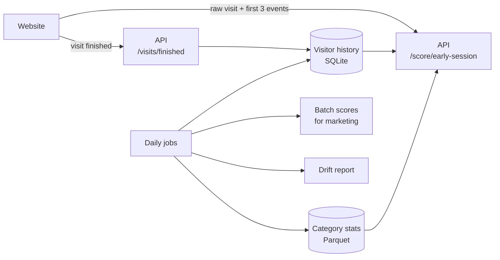

# Sber Autosubscription: conversion prediction

Which website visitors will leave a request for a car subscription? This project predicts it from Google Analytics data of SberAutoPodpiska (1.86M visits and 15.7M events, May to December 2021) and serves the predictions as a daily batch job and a real-time API.

It started as a capstone project and was then taken to production level: features are built from raw visits, production features are tested against the training features, traffic drift is monitored, and the service runs in Docker with CI.

## Results

Tested once on December 2021, after every choice was made on November:

| Model | Used for | ROC-AUC | Top 10% lift | Top 30% catch |
|---|---|---|---|---|
| Blend of LightGBM, XGBoost and CatBoost | session start: where to spend the marketing budget | **0.685** | 2.8x | 55% of conversions |
| LightGBM with the first 3 events | early session: whom to offer a chat or a callback | **0.780** | 3.7x | 71% of conversions |

Only 2.9% of visits convert. A model on raw attributes reached 0.612 under the same honest split. November and December scores are almost the same (0.687 and 0.685, 0.791 and 0.780), so the result is stable.

## Main decisions

1. **Time-based validation.** Train May to October, choose on November, test on December once. A random split gave 0.705, but a third of the test visitors also appeared in training, and in real use the model always predicts the future.
2. **Features that survive new campaigns.** A quarter of December campaigns never appeared in training. Instead of campaign IDs, the model uses each campaign's past conversion rate (smoothed and computed only from earlier days), campaign age, visitor history and the landing page. Removing the raw IDs improved the score.
3. **Two models for two moments.** At session start the model hit a ceiling around 0.69. Scoring after the first 3 events raised it to 0.78 and gives the website a separate use case.
4. **Explained and checked with statistics.** SHAP shows that the session-start score depends on traffic quality, and the early score on early behaviour such as opening a car card. Tests on the data show that organic traffic converts 90% better than paid, social ads 39% worse than other paid traffic, and that the mobile vs desktop gap reverses inside channels.

## How it runs



- **`src/features.py`** builds all 90 features from a raw visit. The API and the batch job share it.
- **Category stats** (past and recent conversion of every source, campaign, city and device) are rebuilt daily. **Visitor history** is rebuilt daily and updated after every visit, so a second visit on the same day already knows about the first.
- **`tests/test_parity.py`** proves that production features equal the training features on a full December day, and that the API replaying 300 visits one by one returns the same scores as the batch job. It found two real training-serving bugs while it was being written.
- **`src/monitor.py`** reports the PSI of the model's probability, of behaviour features and of the traffic mix, the share of unseen categories, and ROC-AUC once outcomes arrive. It flags the December drift that the data audit found.

Details: [reports/07_pipeline_api.md](reports/07_pipeline_api.md).

## Run it

With Docker (the repo includes a feature store as of 1 December 2021):

```bash
docker build -t sber-conversion .
docker run -p 8000:8000 sber-conversion
```

Open http://localhost:8000/docs, or:

```bash
curl -X POST localhost:8000/score/early-session -H "Content-Type: application/json" -d '[{
  "session_id": "demo-1", "client_id": "visitor-1", "visit_dt": "2021-12-01T11:20:00", "visit_number": 1,
  "utm_source": "ZpYIoDJMcFzVoPFsHGJL", "utm_medium": "banner", "device_category": "mobile",
  "device_os": "Android", "device_screen_resolution": "393x786", "device_browser": "Chrome",
  "geo_country": "Russia", "geo_city": "Moscow", "landing_path": "sberauto.com/cars/skoda/rapid",
  "first_events": ["view_card", "photos", "view_card"]}]'
```

Locally:

```bash
pip install -r requirements-dev.txt
make test            # 22 tests on synthetic data; the parity test runs when the original data is present
make api
```

Daily jobs, with the original data in `data/processed`:

```bash
make store DAY=2021-12-15      # rebuild the feature stores
make score DAY=2021-12-15      # score the day for marketing
make monitor DAY=2021-12-15    # drift and quality report
```

## Repository

```
notebooks/   01 data audit, 02 validation, 03 features, 04 experiments, 05 first model,
             06 more features, 07 other models, 08 final test, 09 SHAP, 10 hypotheses
reports/     a write-up of every step, with figures
src/         features, stores, batch job, API, monitoring
tests/       unit tests on synthetic data, parity test on real data
models/      trained models, model card, monitoring reference
store/       category stats as of 2021-12-01 (aggregates only)
```

Notebooks are kept as `.py` files in percent format and converted with `python src/make_nb.py <file>.py`.

## Limitations

- The data covers May to December 2021, so the models describe that period.
- Visitor history lives in SQLite, which is enough for one server. Higher traffic would need Redis or a database table behind the same interface.
- Retraining is manual. A scheduled retraining job, triggered by the drift report, is the next step.

## Data

The raw data (`ga_sessions.csv`, `ga_hits.csv`) was provided by Skillbox and SberAutoPodpiska and is not included. Campaign and source names in the data are already hashed.

Author: Yulia Vovk
