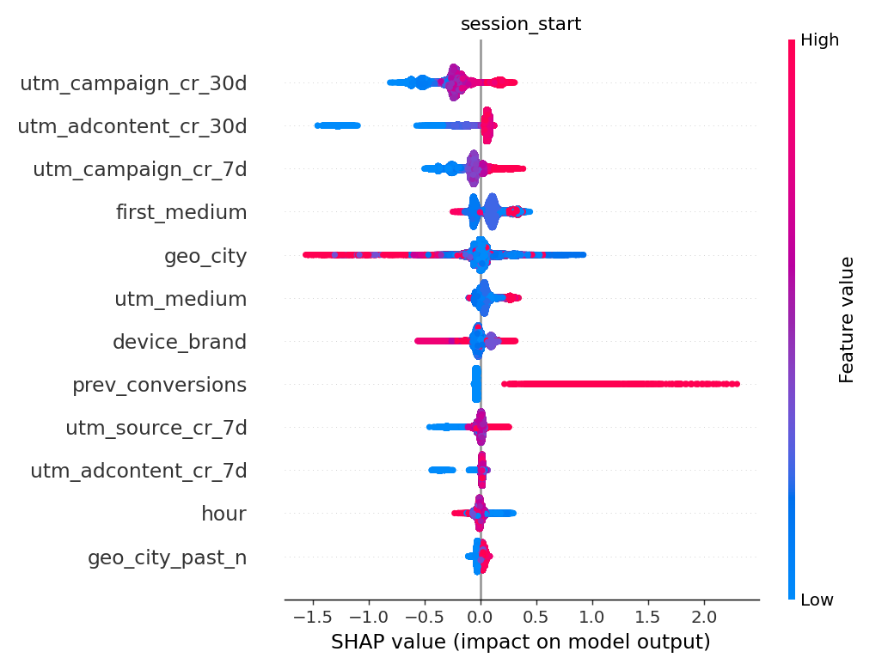
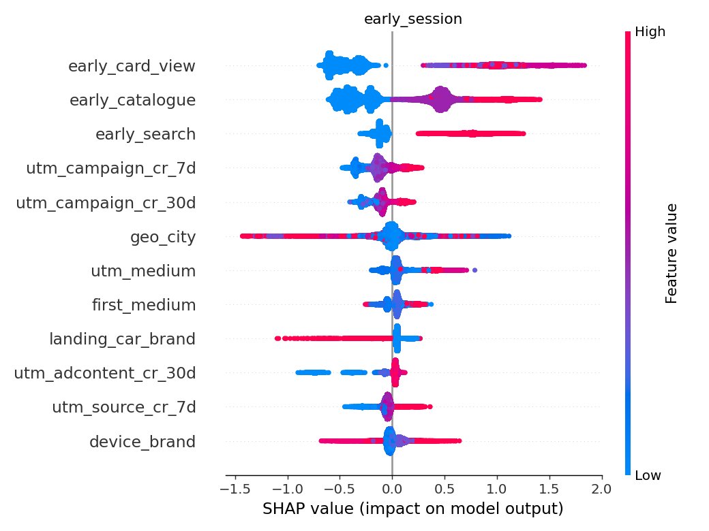

# Step 9. Explaining the models (SHAP)

Notebook: `notebooks/09_shap.ipynb`

**What we did:** SHAP splits every prediction into a contribution from each feature. We averaged the contributions over 100,000 December sessions.

**Why:** two reasons. The business wants to know *why* a visitor scores high, and we want to check the model learned sensible patterns rather than artefacts.

## Session-start model: what drives the score

| Rank | Feature | Share of importance | Meaning |
|---|---|---|---|
| 1 | Campaign conversion rate, last 30 days | 17% | good campaigns bring good visitors |
| 2 | Creative (ad) conversion rate, last 30 days | 8% | |
| 3 | Campaign conversion rate, last 7 days | 7% | |
| 4 | Channel of the visitor's first visit | 7% | how the visitor originally found the site |
| 5 | City | 5% | |
| 8 | Visitor's previous conversions | 3% | returning converters convert again |

**Takeaway:** the score is mostly about **traffic quality**: which campaign and creative the visitor came from, and how well it has been converting recently.

The rolling 7/30-day rates did not raise ROC-AUC, but the model still relies on them most. They carry the same information as the cumulative rates, just fresher, so the model swapped one for the other.

## Early-session model: what drives the score

| Rank | Feature | Share of importance |
|---|---|---|
| 1 | Car cards opened in the first 3 events | 19% |
| 2 | Catalogue browsing in the first 3 events | 14% |
| 3 | Search in the first 3 events | 8% |
| 4–5 | Campaign conversion rate (7 / 30 days) | 10% |

**Takeaway:** once we see a few events, **behaviour beats traffic source**. A visitor who opens a car card straight away is showing real intent.

## Sanity check

Every top numeric feature pushes the score in the direction you would expect. A higher campaign conversion rate, more previous conversions, or more car-card views all **raise** the probability. Nothing looks like leakage or an artefact.
